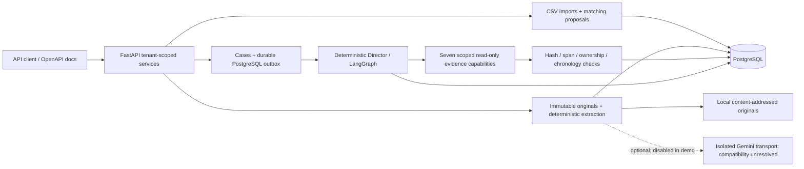

# ClearLedger

**Evidence-driven accounts-receivable reconciliation and deduction investigation
for an Indian B2B distributor.** An INR-only backend that connects receipts,
invoices and source documents, then produces traceable proposals for human review.

This portfolio proves a complete **ingestion → reconciliation candidate → deduction
evidence → LangGraph investigation → actionable review** workflow. It does not claim
production readiness, autonomous settlement or demonstrated live-LLM accuracy.

## Run one complete accountant workflow

After the Windows setup below:

```powershell
uv run --frozen python scripts/portfolio_demo.py
```

The command uses actual FastAPI routes through **in-process TestClient**, real
PostgreSQL, the existing outbox and the production LangGraph executor. No API
responses are mocked. It creates and cleans disposable databases; it does not
populate or reset your development database. External AI is forced off.

**Observed output excerpt**, reproduced locally with five passing demo scenarios:

```text
PRIMARY WORKFLOW: one invoice / receipt / remittance / case / claim
Invoice=1101 paise; receipt=1000 paise
Candidate: UNRESOLVED -> UNIQUE cash=1000 remaining_AR=101
Source-backed claim=101 paise; receipt correlation=LINKED; verified citation records=1
Review: SUPPORTED / HUMAN_REVIEW / AWAITING_REVIEW
Action: review the 101-paise rebate against cited promotion; no adjustment approved
Actual AR=1101; cash unapplied=1000; verified settlement=0 (paise, unchanged)
```

Every stage uses the **same linked receipt, invoice, document, claim and case**:

| Stage | Explicit expected result checked by the demo |
|---|---|
| CSV ingestion | Invoice outstanding 1,101 paise; bank entry creates a 1,000-paise receipt |
| Conservative reconciliation | UNRESOLVED without verified intent; after explicit test attestation, one 1,000-paise candidate retains 101 paise AR |
| Source-backed deduction | Strict remittance extracts a 101-paise rebate assertion; verified test UTR links it to the same receipt/case |
| Evidence investigation | Test-signed promotion supports the 101-paise source predicate; real LangGraph retrieval/verifier produces a cited finding |
| Accountant handoff | SUPPORTED / HUMAN_REVIEW; case AWAITING_REVIEW; inspect cited promotion before making any adjustment |
| Financial safety | Invoice still 1,101 paise open; receipt still 1,000 paise unapplied; verified settlement 0 |

**Working:** one continuous workflow to human review, supported by explicit
assertions—not a sequence of unrelated screenshots. **Not demonstrated:** an
approved adjustment, settlement or posting. The 101-paise residual is a candidate's
unpaid AR, not an already-applied balance. `SUPPORTED` authenticates a source
predicate within the fixture, not the legitimacy or approval of a deduction.

All data are tiny application-owned synthetic code fixtures. Matching intent/UTR
attestations and publisher signatures are explicitly configured **test trust**;
no customer identity, payment intent or financial authority is inferred from text.

Supplementary actual-API controls demonstrate:

```text
Matching: NO_SUPPORTED_MATCH -> EXACT_MATCH (explicit synthetic test attestation)
Document: DETERMINISTIC SUCCEEDED claim_amount_paise=101
Investigation[supported]: SUPPORTED HUMAN_REVIEW citations=1 tools=3
Investigation[missing]: INSUFFICIENT_EVIDENCE REQUEST_EVIDENCE citations=0 tools=3
Investigation[conflict]: INSUFFICIENT_EVIDENCE REQUEST_EVIDENCE citations=2 tools=3
Human review REQUIRED; financial authority FALSE; financial non-mutation PASS (5 scenarios)
External AI DISABLED; no posting or approvals; no benchmark access
```

Missing/conflicting evidence produces a concrete request-evidence action rather than
a guessed allowance. These are deterministic typed recommendations; no fake output
is presented as live AI reasoning. The primary workflow is asserted in
[tests/test_portfolio_demo.py](tests/test_portfolio_demo.py); per-step evidence and
reproduction details are in [the demo walkthrough](docs/PORTFOLIO_DEMO.md).
Actual synthetic observations are saved under ignored `local-data/portfolio-demo/`.

## Architecture



Domain/services, repositories and APIs remain separate. Integer **paise** is used
throughout, with explicit Decimal boundaries. Proposals use tenant scope,
idempotency, optimistic versions and stale-state checks. Document originals and
audit histories are immutable; evidence failures abstain.

The Investigator has only allowlisted read-only tools; the Director is
deterministic. Source facts, contradictions and missing information remain distinct
from financial authority. The separate accounting simulator requires independent
authorization/maker-checker gates; local actor labels or bearer tokens cannot
satisfy production finance identity. The demo invokes no finance operation.

| Layer | Technology |
|---|---|
| Backend | Python 3.12, FastAPI, Pydantic v2 |
| Persistence | PostgreSQL 16.15, SQLAlchemy 2, psycopg, Alembic |
| Investigation | LangGraph with PostgreSQL checkpoints/outbox; deterministic Investigator |
| Documents | pypdf, bounded parser processes, SHA-256 and canonical spans |
| Optional model | Official Google GenAI SDK; external calls disabled by default |
| Quality | pytest, Hypothesis, Ruff, scoped mypy checks, GitHub Actions configuration |
| Local runtime | Docker Compose PostgreSQL; backend runs on Windows |

No frontend, Redis, MCP server, vector database or live bank/ERP connection is
needed. See [architecture](docs/ARCHITECTURE.md) and [financial invariants](docs/DOMAIN_AND_ACCOUNTING.md).

## Windows setup

Requirements: Python **3.12**, `uv`, running Docker Desktop with Compose, PowerShell.
From the repository root:

```powershell
uv sync --frozen
if (-not (Test-Path .env)) { Copy-Item .env.example .env }
```

Edit ignored `.env`: choose local PostgreSQL credentials; align POSTGRES_USER,
POSTGRES_PASSWORD, POSTGRES_DB, DATABASE_URL and TEST_DATABASE_URL. URL-encode
password characters. TEST_DATABASE_URL needs a local role with CREATEDB; the
walkthrough never migrates or drops the database named in that URL.

```powershell
Get-NetTCPConnection -State Listen -LocalPort 5432 -ErrorAction SilentlyContinue
docker compose config --quiet
docker compose up -d --wait db
uv run --frozen python scripts/portfolio_demo.py
```

If 5432 is occupied, set POSTGRES_PORT=5433 **before starting Compose** and use 5433
in both Windows URLs. Preserve the existing process/database.
Windows URLs use `postgresql+psycopg://<user>:<URL-encoded-password>@127.0.0.1:<host-port>/<database>`.
An API inside the Compose network would use `db:5432`; Compose currently starts
only PostgreSQL. Do not remove the named volume. Editing credentials in .env does
not rotate an already-initialized database password.

The demo privately loads the test URL and clears its child Gemini key. Missing
configuration fails explicitly instead of skipping PostgreSQL. Keep defaults:

```dotenv
EXTRACTION_PROVIDER=disabled
EXTERNAL_AI_ENABLED=false
INVESTIGATION_PROVIDER=deterministic
INVESTIGATION_EXTERNAL_ENABLED=false
```

To explore a separately running local API, configure ORGANIZATION_ID and a random
DOCUMENT_API_TOKEN of at least 32 characters in ignored .env, then:

```powershell
uv run --frozen alembic upgrade head
uv run --frozen alembic check
uv run --frozen python -m clearledger.cli init-organization --name "Local synthetic company"
uv run --frozen uvicorn clearledger.main:create_app --factory --host 127.0.0.1 --port 8000
```

Open `http://127.0.0.1:8000/docs`. `/health` checks process health; `/ready` checks
DB connectivity, not migration currency. This server starts empty: the demo uses
separate disposable databases. Some financial import/read routes remain
unauthenticated; loopback and synthetic data only. Never downgrade/reset development
data or expose the local service as a production system.

## Evaluation: measured results, including failures

The frozen independent **development** results below were supplied by the trusted
operator/user. They were not regenerated, rescored or independently re-audited
during this pass. The sealed/blind evaluation remains separate.

| Measurement | Reported/verified result |
|---|---|
| Development stages completed | **255** |
| Snapshot coverage | **Full** for those development stages |
| API-error observations in that run | **0** |
| Conditional matching recall | **0/315** |
| Review-routing score | **0/255** |
| Isolated deterministic LangGraph fixtures | **4 passed**: supported, missing, unsigned, conflicting evidence |
| Real Gemini attempts | **6 failed**; latest minimal plain-text probes returned503,503,504; prior extraction HTTP400 remains unexplained |
| Real LLM extraction accuracy | **Not established** |

Full snapshot/API coverage demonstrates integration completion, **not reconciliation
usefulness**. Zero recall and review-routing scores remain failures to improve;
safe abstention does not establish effective matching. These 255 stages do not
establish completion of the full 420-receipt/sealed study. Small workflow fixtures
are not benchmark accuracy. Fake-provider tests are explicitly offline controls.

Details: [synthetic usefulness](docs/AI_USEFULNESS_EVALUATION.md),
[live Gemini results](docs/LIVE_GEMINI_EVALUATION.md),
[chronological adapter](docs/CHRONOLOGICAL_EVALUATION.md),
[original snapshot](docs/POST_M09_APPLICATION_EVALUATION.md),
[pilot v1.0](docs/PILOT_EVALUATION.md), [pilot v1.1](docs/PILOT_V1_1_EVALUATION.md).
Independent datasets, hidden answers and original operator/scoring code are not demo inputs.

## Known limitations and future work

- **Gemini request compatibility:** an earlier generation returned HTTP400 with no
  known rejected field; the simplified-schema attempt returned503 UNAVAILABLE.
  Three later probes without JSON/schema constraints returned503,503,504 and stopped.
  Neither acceptance of the schema nor real extraction accuracy is established.
  The offline portfolio demo makes no live calls or infrastructure changes.
- **Reconciliation usefulness:** improve source-backed matching and actionable
  review routing, then measure against independent scoring without using answers
  as evidence. The current benchmark scores are not improved by this demo.
- **External evaluation:** DocILE/ContractNLI evaluation is future work, not a
  demonstrated result. Review suitability, licensing and contract mapping first.
- **Sealed blind evaluation:** not claimed complete; preserve hidden-answer isolation.
- **Production identity/security:** trusted user identities, source PKI, stronger
  deployment isolation, backups/storage controls and broader adversarial review
  remain open. Test signatures and tokens never authorize finance.
- **Real-customer validation:** no production bank/ERP integration or real-customer
  acceptance is demonstrated. No Indian tax-compliance claim. OCR and payment-total
  extraction remain unsupported; uncertain sources route to review.

The workflow is complete **to review**, with explicit evidence and residual balances.
Approval/settlement, live AI usefulness and production deployment are separate,
unverified outcomes. No financial rule is changed for a better presentation.

## Checks and contracts

The portfolio gate is `uv run --frozen python scripts/portfolio_demo.py`.
Existing broader gates, when appropriate:

```powershell
uv run --frozen python scripts/verify.py
uv run --frozen python scripts/verify_isolated_restart.py
```

They were not rerun for this pass. The [CI workflow](.github/workflows/verify.yml)
configures disposable PostgreSQL and offline providers; no remote CI result is
claimed. Actual local commands/results and commit hashes are in [STATUS.md](STATUS.md).

Contracts: [CSV v1.0](docs/DATA_CONTRACT.md) · [matching](docs/MATCHING.md) ·
[documents](docs/DOCUMENTS.md) · [cases](docs/CASES.md) · [evidence](docs/EVIDENCE.md) ·
[investigations](docs/INVESTIGATIONS.md) · [accounting simulator](docs/ACCOUNTING_SIMULATOR.md) ·
[review/recovery](docs/REVIEW_RECOVERY.md) · [security](docs/SECURITY.md) ·
[requirements audit](REQUIREMENTS_AUDIT.md).

Dataset research/construction belongs to the independent dataset owner. No realistic
dataset, secret, customer document or private evaluation artifact is committed here.
