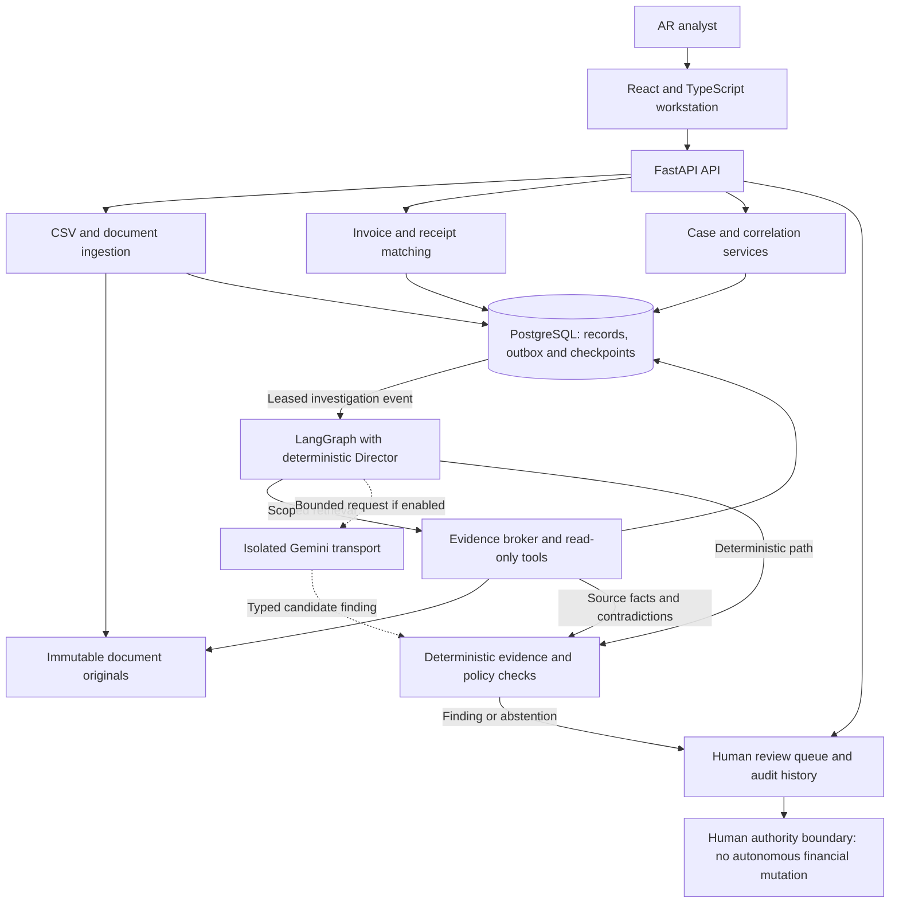
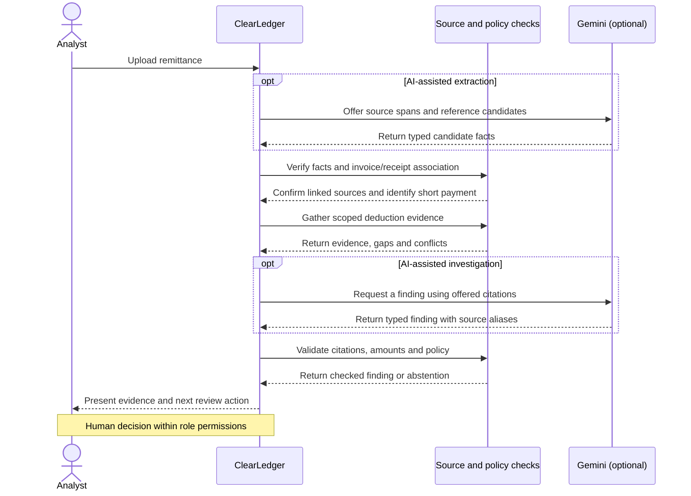
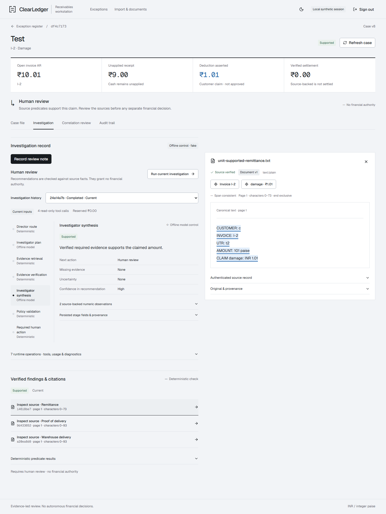

# ClearLedger

**An INR-only reconciliation and deduction investigation workstation for Indian B2B accounts receivable.** ClearLedger links invoices, bank receipts and remittances, then turns unexplained short payments into evidence-backed cases an AR analyst can review.

Matching, evidence verification and financial permissions are deterministic. Optional Gemini extraction and investigation propose typed facts and findings tied to source passages. The reviewer sees what was verified, what remains uncertain and what to do next.

[**Open the live sandbox**](https://clearledger-jduu.onrender.com) · Continue as Demo Analyst to explore synthetic invoices, receipts, remittances, and evidence-backed cases. Try deterministic extraction with the downloadable sample. Upload only synthetic or non-confidential content. Optional Gemini requests use your key for one request at a time. The included synthetic run is currently disabled pending a dedicated demo key. The sandbox has no financial authority, and the API can take about a minute to wake after inactivity.

[Watch the 63-second workstation demo](docs/media/clearledger-workstation.webm) ·
[Run locally](#running-locally) ·
[See measured results](#evaluation) ·
[Deployment runbook](docs/DEPLOYMENT.md)

## Why ClearLedger

A bank receipt says how much arrived. A remittance may explain which invoices it covers and why the customer paid less. The proof for a rebate, damaged shipment or missing delivery may be in another document. AR teams have to link those records, check whether the deduction is supported and distinguish unapplied cash from a legitimate adjustment. A wrong assumption can apply cash to the wrong invoice or reduce an open balance without approval.

## What it does

- **Ingests and links records.** Imports invoice and bank data, preserves original remittances, and extracts typed references and deduction claims with source locations. Versioned correlation checks customer, receipt and invoice evidence.
- **Proposes cash matches.** Checks exact matches and bounded multi-invoice or partial-payment candidates. Unverified intent, conflicting sources and stale versions can block an association or route it for review.
- **Investigates deductions.** Collects scoped read-only evidence, surfaces missing or conflicting facts, and independently checks the finding against current sources. A supported finding still requires human review.
- **Keeps a reviewable history.** Shows the remittance, exact citations, the investigation trace, correlation decisions and case events. A separate gated accounting simulator models approved financial treatment in integer paise.

## System architecture



PostgreSQL holds the durable workflow and ledger state. The transactional outbox
couples case changes to job creation, and the worker leases events and saves
investigation progress. The evidence broker controls source scope. Gemini receives
bounded, privacy-projected inputs through a separate transport and has no database
session or callable posting tools. See the [architecture notes](docs/ARCHITECTURE.md).

### From remittance to review



The diagram shows the linked case path. If correlation cannot be verified, the
case can stop at association review. Investigation can also abstain when the
available evidence does not support a conclusion.

## AI architecture

- **Extraction.** A bounded parser supplies canonical text. Reliable structured
  formats use deterministic extraction. When Gemini is enabled for an approved
  synthetic request, it selects from supplied identifier candidates and evidence
  spans. The application resolves them and validates exact references and
  amounts against the original source.
- **Investigation.** A deterministic Director sets the objective, tools and
  budgets. LangGraph executes the scoped retrieval, optional typed Gemini
  planning and synthesis, independent verification and review transitions. The
  deterministic investigator path runs with external AI disabled.
- **Grounding and abstention.** Request-local aliases resolve to canonical source
  IDs bound to document versions, hashes and exact ranges. Validation checks
  scope, currentness, signatures where required, numeric facts and contradictions.
  Unsupported or ambiguous conclusions can be rejected or sent to review.
- **Trace and authority.** The durable trace records typed actions, provenance,
  policy outcomes and review reasons. It does not persist chain-of-thought.
  Model outputs carry no write or financial authority.

See [canonical source grounding](docs/SOURCE_GROUNDING.md) and the
[investigation contract](docs/INVESTIGATIONS.md).

## Financial safety

The AI path cannot post, allocate cash, write off a deduction, create an
authoritative journal or approve a finance action. An investigation finding
records evidence and a recommendation. A correlation decision establishes a
case association. Neither moves money.

The separate [accounting simulator](docs/ACCOUNTING_SIMULATOR.md) enforces
current evidence, policy and authorization checks. Restricted adjustments use
maker-checker approval with an independent reviewer. Demo credentials cannot
satisfy finance identity. Tenant scoping, immutable histories, idempotency keys,
version checks and the transactional outbox protect retries and auditability.
Amounts use integer paise. Tests compare receipt, invoice and financial records
before and after investigation and correlation. See the
[financial invariants](docs/DOMAIN_AND_ACCOUNTING.md) and [security boundaries](docs/SECURITY.md).

## Evaluation

### Fresh external evaluation — Phase 3B

The sealed run used fresh held-out slices and Gemini 3.5 Flash-Lite.

| Benchmark and scope | Result |
| --- | --- |
| **ContractNLI** — 24 test documents, 408 hypotheses | **74.26%** full-denominator accuracy, **0.6782** macro-F1, **94.61%** grounded coverage, **0.4638** Contradiction F1 |
| ContractNLI source binding | **623/623** published canonical quote ranges verified against exact source text |
| **DocILE** — 100 validation documents, mapped invoice identifier | Invoice-reference precision **0.6190**, recall **0.6842**, F1 **0.6500**. Exact ID-set match **72/100** |
| DocILE conditional document_id KILE on 67 tax invoices | Location + exact-text F1 **0.6667** |

ContractNLI measures external legal evidence reasoning. Exact quote binding
establishes provenance, while semantic relevance is scored separately.
Contradiction recall was **0.3478**, and the model over-selected legal evidence.
DocILE measures the mapped invoice identifier only. Candidate misses and false
positive invoice references remain, including two values emitted on non-invoices.
Four terminal HTTP 503s were retained across the two scored runs.

These results establish neither AR accuracy nor full invoice understanding.
Earlier external phases used different slices, so cross-phase comparisons are
descriptive. See [Phase 3B results, scoring and seals](docs/EXTERNAL_EVALUATION_PHASE3B.md).

### Product performance benchmark

**100 timed synthetic workflows**, 20 measured repetitions per workload, at
product checkpoint `94924cf7f17a26d14143ba317123fd4857f7005f`. The timer starts
at remittance upload with the invoice and bank receipt already imported and
stops at the first usable workflow result.

| Local workflow | p95 |
| --- | ---: |
| Clean extraction | 0.61 s |
| Exact receipt/invoice correlation | 2.68 s |
| Supported short-payment investigation | 6.38 s |
| Missing evidence | 4.99 s |
| Conflicting evidence | 7.26 s |

The run recorded **1,420 HTTP 200 responses**, zero API or application errors,
and zero financial mutations in the measured workflows. Gemini was disabled.
These figures describe local deterministic execution with disposable PostgreSQL
and an in-process API client. They exclude live model latency and establish no
production SLA. See the [performance report and reproducible probe](docs/PERFORMANCE_BENCHMARK.md).

### Sealed private AR benchmark

The one-shot AR benchmark remains **unused**. The trusted operator requires
a custodian-issued `freeze-eval` gate and adjacent passing verification report.
Those prerequisites have not been issued. There is no private AR score for the
frozen product.

## Engineering verification

| Verified checkpoint | Scope |
| --- | --- |
| Phase 3B result checkpoint `7fc1c5b` | **1,076 tests passed** in the frozen gate, including real PostgreSQL integration and migrations. Ruff lint, formatting, strict mypy, dependency locks and matching bounds passed. |
| Contradiction diagnostics checkpoint `f0e9f19` | **4 isolated PostgreSQL restart tests passed** in the earlier restart verification. |
| Performance report checkpoint `4411140` | **125 focused tests passed** after measurement, including correlation, grounded investigation and finance checks. All measured workflows passed before/after financial-state checks. |

See [verification history](STATUS.md) and the [CI configuration](.github/workflows/verify.yml).
The repository provides `uv run --frozen python scripts/verify.py` and
`uv run --frozen python scripts/verify_isolated_restart.py` as separate gates.

## Tech stack

| Layer | Tools |
| --- | --- |
| Application | Python 3.12, FastAPI, Pydantic |
| Data and migrations | PostgreSQL, SQLAlchemy, psycopg, Alembic |
| Investigation | LangGraph, optional Gemini API via the Google GenAI SDK |
| Workstation | React, TypeScript, Vite |
| Local runtime and verification | Docker Compose, Pytest, Hypothesis, Playwright, Ruff, mypy |

## Important engineering decisions

- **Why PostgreSQL instead of Redis?** Durable case state, idempotency, leases,
  outbox delivery and checkpoints live alongside transactional records.
  An additional queue could make sense if measured throughput or latency
  justifies it.
- **Why LangGraph?** The investigation has explicit transitions, bounded tool
  loops, checkpoint recovery and stale-input handling. The graph makes those
  steps inspectable while the Director and verifier remain deterministic.
- **Why human review?** Automation gathers and checks evidence. People retain
  authority over decisions that require context, role permissions or independent
  approval.
- **Why external AI defaults off?** The local product and demo run without a
  provider key. External calls require explicit operator configuration,
  source/privacy admission and bounded requests.

## Demo and screenshots



[Watch the workstation walkthrough](docs/media/clearledger-workstation.webm) ·
[Exception queue](docs/screenshots/exception-queue.png) ·
[Source highlighting](docs/screenshots/evidence-source-highlighting.png) ·
[Correlation decision](docs/screenshots/correlation-decision.png) ·
[Technical investigation trace](docs/screenshots/technical-ai-trace.png)

The walkthrough uses synthetic fixtures, real FastAPI routes, PostgreSQL and the
actual LangGraph executor. The UI's optional provider paths use labelled offline
controls. A separate [bounded live acceptance report](docs/LIVE_ACCEPTANCE.md)
records real Gemini trials and their limitations.

## Running locally

On Windows, use PowerShell with Python **3.12**, `uv`, Docker Desktop with
Compose and Node.js **24** for the UI. Run from the
repository root.

```powershell
uv sync --frozen
if (-not (Test-Path .env)) { Copy-Item .env.example .env }
```

Edit the ignored `.env` with local PostgreSQL settings. Align
`POSTGRES_USER`, `POSTGRES_PASSWORD`, `POSTGRES_DB`, `DATABASE_URL` and
`TEST_DATABASE_URL`. URL-encode password characters in connection URLs. The
test role needs `CREATEDB` for the disposable demo databases. If port 5432 is
occupied, set `POSTGRES_PORT` and use the same host port in both URLs.

```powershell
docker compose config --quiet
docker compose up -d --wait db
uv run --frozen python scripts/portfolio_demo.py
```

The API-only demo runs one continuous invoice, receipt and remittance case
through review. The synthetic short payment leaves 101 paise of candidate
unpaid AR, while actual balances remain unchanged. See the
[demo walkthrough and expected outcomes](docs/PORTFOLIO_DEMO.md).

For the browser workstation, start the two processes in separate terminals.

```powershell
# Terminal 1
npm.cmd --prefix frontend ci
uv run --frozen python scripts/serve_frontend_demo.py

# Terminal 2
npm.cmd --prefix frontend run dev
```

Open [the local workstation](http://127.0.0.1:5173). Read the generated demo
login privately from ignored `local-data/frontend/access.json`. Try
`INV-2026-1042` for missing evidence or `INV-2026-1043` for supported evidence.
Stop the API demo host with Ctrl+C to clean up its disposable database. No
Gemini key is needed. Keep the default external AI settings disabled for this
walkthrough. See [frontend setup, API boundaries and browser checks](FRONTEND.md).

## Repository and evaluation integrity

External evaluations freeze sample IDs, model configuration and scoring rules
before inference. The workers receive source-only packets. Predictions are sealed
before scorers read gold annotations. Reports record benchmark-specific denominators,
provider failures, provenance checks and hashes. Raw evaluation documents, private
answers and credentials stay outside Git.

## Current limitations

- The application is a local, synthetic-data portfolio project. Production deployment,
  real-customer validation and live bank or ERP integrations are unverified.
- The sealed private AR benchmark is blocked at the custodian gate. External
  legal reasoning and invoice-ID scores do not establish AR matching quality.
- Contradiction reasoning remains imperfect, and DocILE coverage is limited to the
  invoice identifier. The product latency benchmark excludes external AI.
- Finance remains behind verified identity, deterministic policy and human
  authorization. Autonomous financial posting is outside scope.

## Roadmap

Finish deployment-facing UX polish, package deployment, harden production identity
and integrations, and validate with real customers if suitable access is available.
